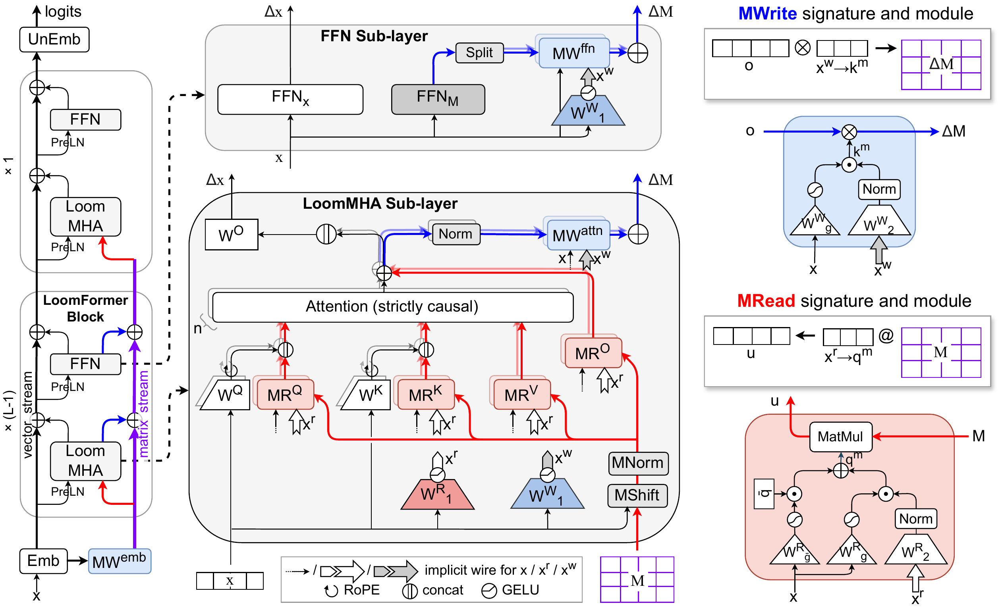
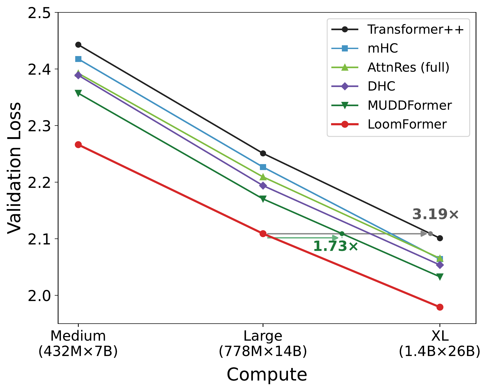
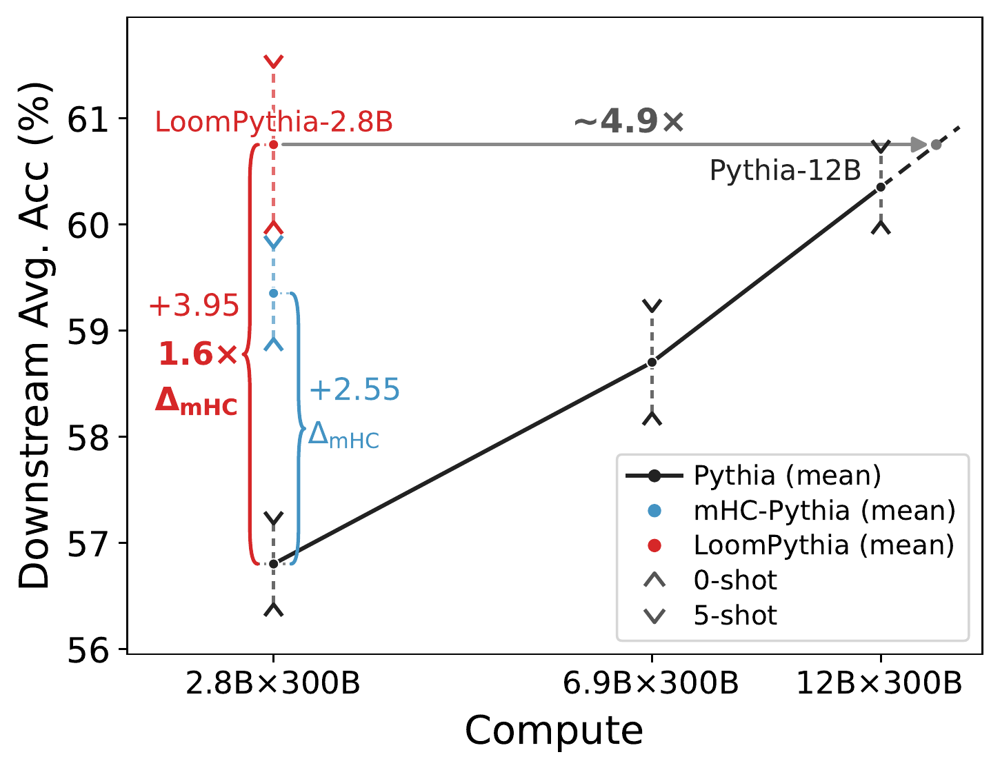

# LoomFormer

This repository contains the official **JAX** (TPU Pallas) and **PyTorch** (HuggingFace + Triton) training and inference code for our paper:

> **Rewirable Circuits in Transformers with Loom Attention**  
> Da Xiao, Qingye Meng, Shengping Li, Xingyuan Yuan  
> *Beijing University of Posts and Telecommunications & ColorfulClouds Technology*

<p align="center">
  
</p>

## About

Transformers solve tasks by composing attention heads across layers into circuits, yet the vertical composition between heads is fixed after training by static projection products (*virtual weights*). While attention makes the **horizontal** flow across tokens input-dependent, the **vertical** flow across heads remains static—and recent multi-stream or depth-attention architectures (DenseFormer, HC/mHC, MUDDFormer, AttnRes) only aggregate already-summed layer hidden states rather than individual heads.

We propose **loom attention**, which enables a Transformer to dynamically rewire its head-to-head circuits at every token by interweaving a head's **vertical attention** over the outputs of earlier heads (to construct its query, key, value, and local output bypass) with its **horizontal attention** over tokens. Vertical attention is instantiated efficiently via normalized and gated linear attention over a fixed-size per-token matrix memory $M_t \in \mathbb{R}^{d_k \times d}$, yielding **LoomFormer**, a dual-stream architecture that cleanly separates **control** (vector residual stream $x_t \in \mathbb{R}^D$) and **content** (matrix memory stream $M_t \in \mathbb{R}^{d_k \times d}$).

Across model scales and token budgets:
- **Scaling Efficiency**: LoomFormer matches standard Transformers trained with **$>3\times$ compute** ($3.19\times$ at Large scale) and outperforms recent residual-stream architectures (HC/mHC, MUDDFormer, AttnRes) trained with **$1.7\times\text{--}2.8\times$ compute**.
- **300B-Token Pretraining (`LoomPythia-2.8B`)**: Trained on 300B Pile tokens under the exact Pythia recipe with matched parameters (`2.78B`) and only **$+1.95\%$ extra FLOPs**, `LoomPythia-2.8B` improves 10-task average accuracy over `Pythia-2.8B` by **$+3.6$ (0-shot)** and **$+4.3$ (5-shot)**—$1.6\times$ the gain of `mHC-Pythia-2.8B`—matching `Pythia-12B` in 0-shot (`59.9`) and **surpassing `Pythia-12B` in 5-shot (`61.6` vs. `60.8`)** and out-of-domain FLAN perplexity (`6.94` vs. `7.26`).
- **Practical Throughput**: With custom fused **TPU Pallas** training kernels and **GPU Triton + CUDA-graph** inference kernels, LoomFormer sustains **$89\%\text{--}92\%$** of matched-size Transformer training speed on TPU v5p and **$84\%\text{--}92\%$** of prefill/decode inference speed on GPU.

<p align="center">
  
  &nbsp;&nbsp;
  
</p>

## Pretrained Models & Main Results

We release **[LoomPythia-2.8B](https://huggingface.co/Caiyun-AI/LoomPythia-2.8B)** pretrained on 300B tokens of the Pile on HuggingFace 🤗:

| Model | Params | Tokens | Pile ppl $\downarrow$ | FLAN ppl $\downarrow$ | 0-shot Avg (10 tasks) $\uparrow$ | 5-shot Avg (10 tasks) $\uparrow$ |
|---|---:|---:|---:|---:|---:|---:|
| Pythia-2.8B | 2.78B | 300B | 6.63 | 8.16 | 56.3 | 57.3 |
| Pythia-6.9B | 6.86B | 300B | 6.29 | 7.85 | 58.1 | 59.3 |
| mHC-Pythia-2.8B | 2.78B | 300B | 6.24 | 7.35 | 58.8 (+2.5) | 59.9 (+2.6) |
| Pythia-12B | 11.85B | 300B | **6.01** | 7.26 | **59.9** | 60.8 |
| **[LoomPythia-2.8B](https://huggingface.co/Caiyun-AI/LoomPythia-2.8B)** | **2.78B** | **300B** | 6.02 | **6.94** | **59.9 (+3.6)** | **61.6 (+4.3)** |

### Quickstart (HuggingFace Transformers)

```python
import torch
from transformers import AutoModelForCausalLM, AutoTokenizer

model_id = "Caiyun-AI/LoomPythia-2.8B"
tokenizer = AutoTokenizer.from_pretrained(model_id, trust_remote_code=True)
model = AutoModelForCausalLM.from_pretrained(
    model_id, trust_remote_code=True, dtype=torch.bfloat16
).cuda().eval()

inputs = tokenizer("In quantum mechanics, the Schrödinger equation describes", return_tensors="pt").to("cuda")
output_ids = model.generate(**inputs, max_new_tokens=64, do_sample=False)
print(tokenizer.decode(output_ids[0], skip_special_tokens=True))
```

For maximum throughput, `pytorch/fast_inference` provides fused Triton kernels + static KV/$M$ caches compatible with `torch.compile` CUDA graphs (see [`pytorch/README.md`](pytorch/README.md)).

## Repository Structure

In practice, we train LoomFormer on Cloud TPUs for large-scale training efficiency and run inference on GPUs for deployment convenience:

- **[`jax/`](jax/)**: Standalone JAX/Flax training package built on unmodified [AI-Hypercomputer/maxtext (`maxtext-v0.2.0`)](https://github.com/AI-Hypercomputer/maxtext/releases/tag/maxtext-v0.2.0) as an external dependency, including both a concise pure-JAX reference implementation aligned with the paper's equations (`jax/loomformer/loom.py`) and custom fused forward/backward TPU Pallas kernels (`jax/loomformer/loom_pallas.py`). See [`jax/README.md`](jax/README.md).
- **[`pytorch/`](pytorch/)**: HuggingFace-compatible PyTorch implementations (`loompythia/` and `loomformer/`), fused Triton training engine + multi-GPU DDP pretraining (`training/engine.py`, `training/triton_ops.py`, `train_loom.py`), fused Triton + CUDA-graph inference engine (`fast_inference/`), MaxText-to-HuggingFace checkpoint converter (`scripts/convert_maxtext_to_hf.py`), and test suite. See [`pytorch/README.md`](pytorch/README.md).

## Citation

If you find LoomFormer useful in your research, please cite:

```bibtex
@article{xiao2026loomformer,
  title={Rewirable Circuits in Transformers with Loom Attention},
  author={Xiao, Da and Meng, Qingye and Li, Shengping and Yuan, Xingyuan},
  year={2026}
}
```

## License

This project is licensed under the Apache License 2.0 — see [`LICENSE`](LICENSE) for details.
