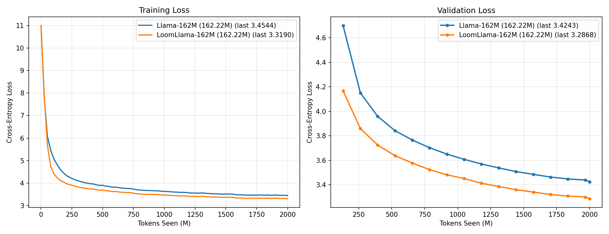

# LoomFormer — PyTorch Training, Inference & Triton Kernels (`pytorch/`)

This directory provides HuggingFace-compatible PyTorch implementations of **LoomPythia** and **LoomFormer**, together with:

1. **Fused Triton Training Engine & DDP Pretraining** (`training/engine.py`, `training/triton_ops.py`, `train_loom.py`): separates the fast Triton training wrapper (`build_train_model(hf_model, grad_checkpoint=False)`, mirroring `fast_inference/engine.py` with live HF parameters) from the pure HuggingFace reference in `loomformer/`, reusing `fast_inference/kernels_llama.py` with zero-spill autograd backward kernels, `torch.compile` (0 graph breaks), optional `--grad-checkpoint`, parameter-matched presets (`160m`, `medium`), and FineWeb10B scripts.
2. **Fused Triton + CUDA-Graph Fast Inference Engine** (`fast_inference/`): static KV/$M$ cache wrappers for high-throughput prefill and autoregressive decode.
3. **MaxText-to-HuggingFace Converter** (`scripts/convert_maxtext_to_hf.py`): converts Orbax OCDBT MaxText checkpoints directly to standalone HuggingFace `safetensors` directories.

We release **[LoomPythia-2.8B](https://huggingface.co/Caiyun-AI/LoomPythia-2.8B)** (pretrained on 300B Pile tokens) on HuggingFace 🤗.

---


## Installation

```bash
cd pytorch
pip install -r requirements.txt
```

*(Tested with Python 3.10/3.11,* `torch >= 2.5`*,* `triton >= 3.1`*,* `transformers >= 4.46` *on NVIDIA A800 / RTX PRO 6000 GPUs.)*

---


## Directory Overview

```text
pytorch/
├── loompythia/                  # HF LoomPythiaConfig & LoomPythiaForCausalLM (Pythia backbone + QKNorm)
├── loomformer/
│   ├── configuration_loomformer.py
│   └── modeling_loomformer.py   # Pure HF LoomFormerForCausalLM reference (LoomLlama & matched Llama baselines)
├── fast_inference/              # Fused Triton + CUDA-graph inference engine (`fast_inference.build(hf_model)`)
│   ├── engine.py                # Static KV/M caches, prefill, and CUDA-graph decode wrappers
│   ├── kernels_pythia.py        # Fused MWrite+MShift+MNorm+MRead+QKNorm+RoPE kernels (LoomPythia)
│   ├── kernels_llama.py         # Fused MWrite+MShift+MNorm+MRead+RoPE kernels (LoomFormer / shared with training)
│   ├── prefill_attention.py     # Strictly-causal (s < t) Triton FlashAttention + o_m bypass
│   └── decode_attention.py      # CUDA-graph-safe split-KV flash-decoding
├── training/
│   ├── engine.py                # Fused Triton training engine (`build_train_model`, live HF params, optional `--grad-checkpoint`)
│   ├── triton_ops.py            # Fused Triton fwd/bwd autograd ops (`loom_read_triton`, `loom_write_triton`) + FA2 SDPA
│   ├── configs.py               # Parameter-matched presets: `160m` (162.2M), `medium` (432.1M)
│   └── data.py                  # FineWeb10B (`kjj0/fineweb10B-gpt2`) shard downloader & DDP memmap loader
├── train_loom.py                # Single-GPU / multi-GPU (`torchrun` DDP) training & alignment verification entrypoint
├── plot_curves.py               # Plot train/val loss vs. tokens, steps, or wall-clock time
├── scripts/
│   ├── convert_maxtext_to_hf.py # MaxText Orbax OCDBT / .npz -> HuggingFace safetensors converter
│   └── benchmark_inference.py   # Prefill & CUDA-graph decode latency benchmark
└── tests/
    ├── test_loom_pytorch.py     # KV+M cache, chunked prefill, left-padding, generate(), fast_inference parity
    └── test_loom_training.py    # Triton fwd/bwd grad parity, torch.compile (0 breaks), training & inference alignment
```

---


## 1. PyTorch Pretraining (LoomFormer vs. Matched Llama)

`train_loom.py` trains parameter-matched **LoomFormer** (`--loom`) and standard **Llama** (`--no-loom`) models on FineWeb10B binary shards from `[KellerJordan/modded-nanogpt](https://github.com/KellerJordan/modded-nanogpt)` (`kjj0/fineweb10B-gpt2`), which are downloaded automatically on rank 0.

### Built-in Model Presets (`--preset`)


| Preset   | Params (Loom / Llama) | Geometry (`D, L, n, d`) | Loom (`d_k, d_r, r`) | Notes                                |
| -------- | --------------------- | ----------------------- | -------------------- | ------------------------------------ |
| `160m`   | 162.22M / 162.22M     | `768, 12, 12, 64`       | `24, 128, 16`        | 2B-token FineWeb benchmark below     |
| `medium` | 432.11M / 432.12M     | `1200, 18, 16, 75`      | `32, 256, 18`        | Paper Medium architecture (`T=4096`) |


### Reproducing the FineWeb Pretraining Experiments

The `160m` command below trains for **2B tokens** (`7630 steps × 256 seqs × 1024 tokens/seq`) on 8 GPUs using AdamW with cosine decay (`warmup_steps=150`, `min_lr_ratio=0.1`). Switch `--loom` to `--no-loom` to run the parameter-matched Llama baseline. Add `--grad-checkpoint` (optional, off by default) for full per-layer activation checkpointing matching JAX `remat_policy="full"`.

```bash
# 162M (2B tokens, lr=1e-3) — replace `--loom` with `--no-loom` for Llama-162M
torchrun --standalone --nproc_per_node=8 pytorch/train_loom.py \
  --preset 160m --loom --compile \
  --steps 7630 --batch-size 256 --micro-batch-size 32 --seq-len 1024 \
  --lr 1e-3 --warmup-steps 150 --eval-every 500 --num-train-shards 20 \
  --out-dir pytorch/runs/loomllama_162m_2b --save-ckpt

# Paper Medium 432M (`T=4096, B=128, micro_bs=16` with optional `--grad-checkpoint`)
torchrun --standalone --nproc_per_node=8 pytorch/train_loom.py \
  --preset medium --loom --compile --grad-checkpoint \
  --steps 13500 --batch-size 128 --micro-batch-size 16 --seq-len 4096 \
  --lr 3e-4 --warmup-steps 135 --eval-every 500 --num-train-shards 70 \
  --out-dir pytorch/runs/loomformer_medium --save-ckpt

# Plot comparison curves (by tokens, step, or wall-clock time)
python pytorch/plot_curves.py \
  --runs pytorch/runs/llama_162m_2b pytorch/runs/loomllama_162m_2b \
  --labels "Llama-162M (162.22M)" "LoomLlama-162M (162.22M)" \
  --x-axis tokens --out pytorch/runs/compare_162m_2b.png
```

*(On a single GPU, run* `python pytorch/train_loom.py ...` *with the same* `--batch-size`*; gradient accumulation is computed automatically from* `batch_size // (micro_batch_size * world_size)`*.)*

After training completes, `--verify-inference` (enabled by default) converts the trained weights to BF16, builds `fast_inference.build(hf_model)`, and checks end-to-end KL alignment across the Triton training engine (`build_train_model`), pure PyTorch HuggingFace reference (`LoomFormerForCausalLM`), and `fast_inference` prefill + autoregressive decode.

### FineWeb 2B-Token Results & 8×A800 Training Throughput


| Preset & Setting (8×A800, `--compile`)                     | Model                 | Params  | Val Loss (2B tok) $\downarrow$ | Val PPL $\downarrow$ | Steady Throughput  | Relative Speed | Peak Mem |
| ---------------------------------------------------------- | --------------------- | ------- | ------------------------------ | -------------------- | ------------------ | -------------- | -------- |
| `160m` (`T=1024, B=256, micro_bs=32`)                      | Llama-162M            | 162.22M | 3.4243                         | 30.70                | 1,592.6k tok/s     | 100.0%         | 19.69 GB |
| `160m` (`T=1024, B=256, micro_bs=32`)                      | **LoomLlama-162M**    | 162.22M | **3.2868** (−0.138)            | **26.76**            | **1,205.8k tok/s** | **75.7%**      | 24.56 GB |
| `medium` (`T=4096, B=128, micro_bs=16, --grad-checkpoint`) | Llama-Medium          | 432.12M | —                              | —                    | 368.7k tok/s       | 100.0%         | 22.57 GB |
| `medium` (`T=4096, B=128, micro_bs=16, --grad-checkpoint`) | **LoomFormer-Medium** | 432.11M | —                              | —                    | **323.8k tok/s**   | **87.8%**      | 28.67 GB |


At 162M scale, **LoomLlama-162M** reaches `Llama-162M`'s final 2B-token validation loss (`3.4243`) in **~1.14B tokens** (**1.75× token efficiency**) and **77.3% of Llama's wall-clock time**, while matching `fast_inference` prefill + decode to `KL = 1.70e-4` after training.



---


## 2. Standard HuggingFace Generation

`LoomPythiaForCausalLM` and `LoomFormerForCausalLM` support standard `transformers` APIs (`forward`, `generate`, `DynamicCache` with per-layer `loom_m` state, left-padding, and chunked prefill):

```python
import torch
from transformers import AutoModelForCausalLM, AutoTokenizer

model_id = "Caiyun-AI/LoomPythia-2.8B"  # or local checkpoint from `--save-ckpt` / converter
tokenizer = AutoTokenizer.from_pretrained(model_id, trust_remote_code=True)
model = AutoModelForCausalLM.from_pretrained(
    model_id, trust_remote_code=True, dtype=torch.bfloat16
).cuda().eval()

inputs = tokenizer("The capital of France is", return_tensors="pt").to("cuda")
with torch.no_grad():
    out = model.generate(**inputs, max_new_tokens=32, do_sample=False)
print(tokenizer.decode(out[0], skip_special_tokens=True))
```

---


## 3. Accelerated Inference with Triton Kernels & `torch.compile` CUDA Graphs

For maximum prefill and autoregressive decode throughput on CUDA GPUs (~88% of stock `Pythia-2.8B` compiled speed on A800), wrap any loaded model with `fast_inference.build`:

```python
import sys
sys.path.insert(0, "/path/to/LoomFormer/pytorch")

import torch
from transformers import AutoModelForCausalLM, AutoTokenizer
import fast_inference

model_id = "Caiyun-AI/LoomPythia-2.8B"
tokenizer = AutoTokenizer.from_pretrained(model_id, trust_remote_code=True)
hf_model = AutoModelForCausalLM.from_pretrained(
    model_id, trust_remote_code=True, dtype=torch.bfloat16
).cuda().eval()

fast = fast_inference.build(hf_model)  # also accepts GPTNeoXForCausalLM or LoomFormerForCausalLM

prompt_ids = tokenizer(["The capital of France is"], return_tensors="pt").input_ids.cuda()
max_new_tokens = 32
state = fast.new_state(batch=prompt_ids.shape[0], max_len=prompt_ids.shape[1] + max_new_tokens)

# Compile a single CUDA-graph-captured decode step (first call compiles & autotunes)
decode_step = torch.compile(
    lambda tok: fast.decode(tok, state), mode="max-autotune", fullgraph=True, dynamic=False
)

with torch.no_grad():
    nxt = fast.prefill(prompt_ids, state)[:, -1].argmax(dim=-1, keepdim=True)
    generated = [prompt_ids, nxt]
    for _ in range(max_new_tokens - 1):
        nxt = decode_step(nxt)[:, -1].argmax(dim=-1, keepdim=True)
        generated.append(nxt)

print(tokenizer.decode(torch.cat(generated, dim=1)[0]))
```

To reuse the compiled graph on a new prompt of the same batch size, call `state.reset()` and invoke `fast.prefill(...)` again.

---

